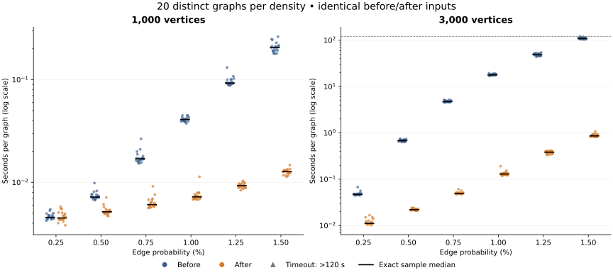

# Adaptive square-search performance

The adaptive search replaces repeated neighborhood walks with streamed
common-neighbor buckets, and uses pairs of missing edges when that search
is estimated to be cheaper. The [algorithm analysis](adaptive-search.md)
explains the selection rule, exact square enumeration, output ordering,
memory tradeoffs, and complexity bounds.

This experiment compares **[`0ebc8fe`](https://github.com/jasonbehrstockdev/SGB/tree/0ebc8fe1460e278edb52fcdf183af57747718d03) before**
with **[`3797211`](https://github.com/jasonbehrstockdev/SGB/tree/3797211c38ca70c52890943c5a28b5c575040d47) after**.
The before build already includes canonical square hashing and shared-diagonal
component discovery from the earlier optimization. Its CFS rule already allows
complete join factors. The measurements isolate the subsequent adaptive-search
changes, rather than comparing against the original 2024 import.

There are **20 distinct graphs per size and density**: 240 graphs at 1,000
and 3,000 vertices, six edge probabilities, and 480 measured application runs.
Each before/after pair reads the same input file. There is one fresh-process
measurement per build per graph, with a **120-second wall-time limit**.
The [raw results](performance-adaptive-results.json) retain every outcome,
timing, seed, input hash, reference result, execution order, and build hash.

Among groups with all 20 pairs completed, the largest median paired
speedup was **139×** at
**3,000 vertices and 1% edge probability**.
The before build completed **237/240** runs and the adaptive build
completed **240/240**. Their timeout counts were **3**
and **0**, respectively. Each timeout remains an incomplete
analysis, and every completed result matched the reference.

## Paired CLI comparison

Times are **seconds per graph**, including process startup, parsing,
analysis, output, and cleanup. The speedup column is the median of the
within-graph before/after ratios among completed pairs. It can differ
from the ratio of the two group medians. When fewer than 20 pairs finish,
the paired statistic describes only that completed subset.

| Vertices | Edge probability | Before median (s) | After median (s) | Median paired speedup | Completed before / after (of 20) |
| ---: | ---: | ---: | ---: | ---: | --- |
| 1,000 | 0.25% | 0.004553 | 0.004496 | 1.03× | 20 / 20 |
| 1,000 | 0.5% | 0.007188 | 0.005162 | 1.4× | 20 / 20 |
| 1,000 | 0.75% | 0.01695 | 0.006066 | 2.75× | 20 / 20 |
| 1,000 | 1% | 0.04085 | 0.007214 | 5.68× | 20 / 20 |
| 1,000 | 1.25% | 0.09282 | 0.009302 | 9.95× | 20 / 20 |
| 1,000 | 1.5% | 0.2053 | 0.01272 | 15.8× | 20 / 20 |
| 3,000 | 0.25% | 0.04707 | 0.01113 | 4.15× | 20 / 20 |
| 3,000 | 0.5% | 0.6816 | 0.02201 | 30.7× | 20 / 20 |
| 3,000 | 0.75% | 4.733 | 0.04914 | 95.8× | 20 / 20 |
| 3,000 | 1% | 17.89 | 0.1294 | 139× | 20 / 20 |
| 3,000 | 1.25% | 48.97 | 0.3835 | 129× | 20 / 20 |
| 3,000 | 1.5% | 108.9 | 0.8617 | 129× (17 pairs) | 17 / 20 |

A `>` value is a lower bound from right-censored observations. A timed-out
run is not assigned a completed runtime of 120 seconds. Quantiles use the
whole 20-graph sample; when the required order statistics are completed,
a quantile can still be identified despite slower timed-out observations.
Bounds are rounded downward. No exact speedup is inferred from a timeout.



Each dot is one completed run. Upward triangles at the two-minute deadline
mark timeouts; they are not completed times. Black ticks mark identifiable
sample medians. The vertical scale is logarithmic.

### Variation across graphs

These 25th–75th percentile intervals combine graph-to-graph variation and
runtime noise. They are not confidence intervals. Censored bounds are
shown where a percentile cannot be measured exactly.

| Vertices | Edge probability | Before 25th–75th percentile (s) | After 25th–75th percentile (s) |
| ---: | ---: | --- | --- |
| 1,000 | 0.25% | 0.004463 to 0.004781 | 0.004354 to 0.004968 |
| 1,000 | 0.5% | 0.007084 to 0.007614 | 0.004995 to 0.005346 |
| 1,000 | 0.75% | 0.01621 to 0.01744 | 0.005897 to 0.006496 |
| 1,000 | 1% | 0.03938 to 0.04211 | 0.006929 to 0.007471 |
| 1,000 | 1.25% | 0.09101 to 0.09973 | 0.008899 to 0.009663 |
| 1,000 | 1.5% | 0.1921 to 0.2129 | 0.01228 to 0.01308 |
| 3,000 | 0.25% | 0.04591 to 0.04824 | 0.01096 to 0.01233 |
| 3,000 | 0.5% | 0.6618 to 0.6968 | 0.02146 to 0.02278 |
| 3,000 | 0.75% | 4.657 to 4.919 | 0.04858 to 0.05062 |
| 3,000 | 1% | 17.62 to 18.31 | 0.1248 to 0.1358 |
| 3,000 | 1.25% | 46.5 to 51.25 | 0.3681 to 0.4037 |
| 3,000 | 1.5% | 106.2 to 114.5 | 0.8312 to 0.9207 |

## Inputs and structural coverage

The inputs are the same deterministic `G(n,p)` graph instances as the
[previous ensemble study](performance-ensemble.md). Every density has
20 distinct seeds. Reusing each seed across probabilities gives nested
edge sets, so the groups at different densities are correlated.
The measured runs themselves are new; earlier timings are not reused.

The generator uses `seed = 202610300000 + n * 1000 + sample_index`, with
`sample_index` from 0 to 19. Python `random.Random(seed).random()` is called
once per unordered vertex pair in lexicographic order; an edge is added
when the draw is below `p`. Exact input hashes are retained.

| Vertices | Edge probability | Actual density range | Squares, median (range) | Reference CFS graphs |
| ---: | ---: | --- | --- | ---: |
| 1,000 | 0.25% | 0.23864%–0.26687% | 5 (1–9) | 0/20 |
| 1,000 | 0.5% | 0.48368%–0.52653% | 81 (58–111) | 0/20 |
| 1,000 | 0.75% | 0.73193%–0.78659% | 396 (331–464) | 0/20 |
| 1,000 | 1% | 0.97898%–1.0262% | 1,238.5 (1,123–1,365) | 0/20 |
| 1,000 | 1.25% | 1.2222%–1.2805% | 2,973 (2,742–3,300) | 0/20 |
| 1,000 | 1.5% | 1.4783%–1.5347% | 6,080 (5,606–6,698) | 0/20 |
| 3,000 | 0.25% | 0.24304%–0.25295% | 382.5 (338–455) | 0/20 |
| 3,000 | 0.5% | 0.49492%–0.50415% | 6,170 (5,832–6,551) | 0/20 |
| 3,000 | 0.75% | 0.74289%–0.7563% | 31,379 (30,212–32,364) | 0/20 |
| 3,000 | 1% | 0.99186%–1.0068% | 98,755.5 (96,370–102,269) | 0/20 |
| 3,000 | 1.25% | 1.2402%–1.257% | 240,841 (232,986–246,692) | 0/20 |
| 3,000 | 1.5% | 1.4872%–1.5072% | 495,288.5 (478,522–506,483) | 20/20 |

CFS counts in this table come from the independent reference, including
where a timed application run did not finish. They do not turn timeouts
into correctness passes. Complete join factors remain allowed for CFS;
the square graph and its actual supports retain their literal meaning.

## Dense and nearly complete graphs

A [supplemental paired comparison](performance-adaptive-dense-results.json)
uses **20 distinct 100-vertex graphs at each of 50%, 90%, and 98% edge
probability**. It uses the same before/after executables, compiler settings,
two-minute budget, 4 GiB address-space cap, pinned-worker arrangement,
fresh-process timing, and reference validation as the main experiment.
These 60 graphs directly measure the whole ordinary CLI path on dense
inputs. Their timings are reported separately from the larger sparse graphs.

| Vertices | Edge probability | Before median (s) | After median (s) | Median paired speedup | Completed before / after (of 20) |
| ---: | ---: | ---: | ---: | ---: | --- |
| 100 | 50% | 0.833 | 0.0516 | 16.2× | 20 / 20 |
| 100 | 90% | 1.241 | 0.0259 | 48.3× | 20 / 20 |
| 100 | 98% | 0.3304 | 0.007316 | 46.4× | 20 / 20 |

The before build completed 60/60 runs and the adaptive build
completed 60/60; timeout counts were 0 and 0.
Every completed output matched the reference, and every completed pair
had identical CSV. Speedup statistics use only completed pairs; any
censored quantiles retain the full 20-graph group. The raw record
contains the actual densities, reference square/component/support
results, CFS classifications, input hashes, and all individual timings.

## Search scaling

A [separate instrumented study](performance-adaptive-scaling.json) measures
20 graphs at each of four sizes in two parameter regimes. Its timer covers
`findSquares`, including adjacency-cache construction and restoring square
order. It excludes graph construction, CLI parsing, component discovery,
support accumulation, and output. These are search measurements, not extra
end-to-end speedup claims.

The sparse family fixes `alpha = p * sqrt(n) = 0.5`; the dense family fixes
the expected complement degree at 2. Enumeration checks count wedge visits,
pairs within a common-neighbor bucket, or pairs of missing edges. They exclude
cache setup and ordering work. The normalized counts test the predicted
quadratic enumeration growth directly; elapsed times also include allocation
and instrumentation costs.

| Family | Vertices | Graphs | Median search (s) | Median enumeration checks / n² | Median squares / n² | Selected strategies |
| --- | ---: | ---: | ---: | ---: | ---: | --- |
| Fixed α = 0.5 | 250 | 20 | 0.0001999 | 0.15 | 0.0074 | wedges: 20 |
| Fixed α = 0.5 | 500 | 20 | 0.0006327 | 0.145 | 0.007592 | wedges: 20 |
| Fixed α = 0.5 | 1,000 | 20 | 0.00237 | 0.14 | 0.007523 | wedges: 20 |
| Fixed α = 0.5 | 2,000 | 20 | 0.008619 | 0.1383 | 0.007632 | wedges: 20 |
| Complement mean degree 2 | 250 | 20 | 0.00713 | 0.5 | 0.4759 | missing_edges: 20 |
| Complement mean degree 2 | 500 | 20 | 0.0328 | 0.4851 | 0.4731 | missing_edges: 20 |
| Complement mean degree 2 | 1,000 | 20 | 0.1995 | 0.4935 | 0.4874 | missing_edges: 20 |
| Complement mean degree 2 | 2,000 | 20 | 0.97 | 0.504 | 0.501 | missing_edges: 20 |

For the sparse family, doubling the vertex count multiplies the median
enumeration checks by 3.87×, 3.86×, 3.95×.
The corresponding search-time factors are 3.16×, 3.75×, 3.64×.

For the dense family, doubling the vertex count multiplies the median
enumeration checks by 3.88×, 4.07×, 4.09×.
The corresponding search-time factors are 4.60×, 6.08×, 4.86×.

Candidate-check growth is close to the factor of four predicted by
quadratic enumeration. The measured dense search times grow faster over
these sizes. Allocation, sorting buffers, and cache effects are possible
contributors, but this experiment does not isolate their causes. The
data therefore support the operation-count prediction without establishing
quadratic wall-clock growth or an end-to-end quadratic runtime.

Each case has an independently derived square count and checks the
returned squares for valid induced-cycle adjacencies and duplicate keys.
The raw scaling artifact records its exact source/binary/input hashes,
parameters, observations, and separate construction/validation timings.

## Scope of the complexity improvement

For bounded `alpha` with `p = alpha / sqrt(n)`, the streamed-wedge method
has expected quadratic **enumeration** work. For dense graphs with only
`O(n)` missing edges, testing their pairs also uses quadratic enumeration
work. These are parameter-dependent statements; a fixed positive density
can produce quartically many induced squares.

The program still stores its squares, performs disjoint-set component
operations, and builds ordered support sets. Their inverse-Ackermann and
logarithmic factors belong to the full-pipeline analysis. Requested literal
square-graph output also has its own edge-output cost. The theory document
gives these qualifications explicitly. The paired table measures the whole
ordinary `-tf` CLI path, while the separate scaling study concerns search.

## Validation and measurement limits

All **477 completed application outputs in the main 240-graph study**
matched the scalable reference, and all **237 completed pairs** had identical CSV.
The runner validated square/component counts, literal support ratios, graph
connectivity, density, alpha, and the CFS result. The report generator
revalidates completed CSV records and recomputes group summaries before
rendering. No execution or validation failure is present in this artifact.

The [independent verification record](performance-adaptive-validation.json)
checks regenerated inputs, recorded source and binary hashes, completed
outputs, and independently recalculated paired/scaling statistics. The
normal and AddressSanitizer/UndefinedBehaviorSanitizer test suites passed,
including 75 structural cases and 108 forced search/adjacency-backend checks.
The [output-equivalence record](performance-adaptive-equivalence.json)
also confirms byte-identical verbose/debug stdout and stderr on all
15 benchmark graphs and 13 original example records.

The independent reference uses bitset common-neighbor intersections and
components of diagonal nodes. The application uses its own streamed wedge
or missing-edge-pair search. The existing four-vertex-subset structural
oracle and targeted regressions provide an additional, different check.
Graph generation and reference work occur outside each application timer.

Each process has a 4 GiB virtual address-space cap; this is a configured
limit, not a peak-memory measurement. Three workers run on distinct pinned
CPUs 1, 2, and 3, with the supervisor on CPU 0. A pair runs sequentially
on one worker; order alternates by sample index, ten before-first and ten
after-first per group. Other workers share the host, cache, and memory
bandwidth. Small differences remain sensitive to startup and scheduling.

The exact compiler, Boost version, flags, hardware report, source/binary
hashes, command, and timestamps are in the raw record. The old and new
application builds use the same recorded compilation settings. This study
does not establish a portable speedup for every graph family or machine.

Raw result SHA-256: `e4f6546ced56a9668cb5836af11df2e4f93a8e700facca5441247c5796080ad5`.

## Reproduce

Use the revision containing this report and its verification tools. Its
application sources are unchanged from the measured after commit shown
above; the following commits add measurement evidence and documentation.
Build the baseline source separately with the same compiler and flags:

```sh
mkdir -p build/performance-adaptive/before-source
git archive 0ebc8fe1460e278edb52fcdf183af57747718d03 main.cpp flags.h input.h | \
  tar -x -C build/performance-adaptive/before-source
g++ -O2 -std=c++11 -Wall -Wextra -Wpedantic -Werror \
  build/performance-adaptive/before-source/main.cpp -o build/performance-adaptive/SGB-before
make build/SGB build/sgb-reference-large
python3 benchmarks/performance_ensemble.py \
  --before build/performance-adaptive/SGB-before --after build/SGB \
  --reference build/sgb-reference-large \
  --before-source build/performance-adaptive/before-source \
  --before-commit 0ebc8fe1460e278edb52fcdf183af57747718d03 \
  --after-commit 3797211c38ca70c52890943c5a28b5c575040d47 \
  --boost-version 1.83 --samples 20 --vertices 1000 3000 \
  --probabilities .0025 .005 .0075 .01 .0125 .015 \
  --timeout 120 --memory-gib 4 --cpus 1 2 3 --management-cpu 0 \
  --output audit/performance-adaptive-results.json
```

Add the same Boost include directory to both builds where needed. Adapt
the CPU choices to the available affinity mask and retain those choices
in the new provenance. An interrupted run can resume with `--resume` only
when the saved input, executable, source, and settings provenance matches.

After the full experiment, render this report and plot:

```sh
MPLCONFIGDIR=/tmp/sgb-mpl python3 benchmarks/report_adaptive.py
```

The timing runner uses the Python standard library. Plot rendering requires
Matplotlib. Historical reports retain their original measurements and methods.

The dense comparison uses the same runner command and source/build
arguments, replacing the input matrix and output destination with:

```sh
--vertices 100 --probabilities .5 .9 .98 --samples 20 \
  --output audit/performance-adaptive-dense-results.json
```

Run the instrumented scaling study after the paired timings finish:

```sh
make build/adaptive-scaling
python3 benchmarks/adaptive_scaling.py \
  --binary build/adaptive-scaling \
  --application-commit 3797211c38ca70c52890943c5a28b5c575040d47 \
  --boost-version 1.83 \
  --output audit/performance-adaptive-scaling.json
```

Keep the source snapshots, measured executables, and original fixture
files for verification. Capture the test log and output-equivalence
record before running the independent evidence checker:

```sh
make check check-sanitize build/adaptive-scaling \
  > build/performance-adaptive/preflight.log 2>&1
python3 tests/compare_versions.py \
  --before build/performance-adaptive/SGB-before --after build/SGB \
  --before-source build/performance-adaptive/before-source \
  --output audit/performance-adaptive-equivalence.json
python3 benchmarks/verify_adaptive.py
```

Add the same `CPPFLAGS` Boost include setting when necessary. Run the
test and verification commands outside the measured timing intervals.
