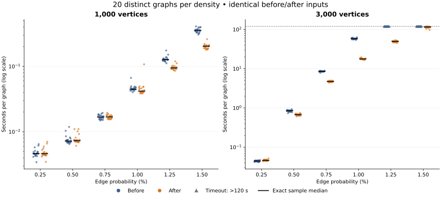

# Twenty-graph density comparisons

This study measures **20 distinct graphs at each of six densities for both
1,000 and 3,000 vertices**: 240 graphs and 480 measured application runs.
Each before/after pair reads exactly the same graph. The per-run wall-time
limit is **120 seconds**. The application source is unchanged from the
[previous optimization](performance.md): the before build is the repaired
baseline `cbdb90f`; the after build uses optimized source `1d780c2`.

The [raw record](performance-ensemble-results.json) preserves every timing,
outcome, seed, input hash, reference result, execution order, and build hash.
Unlike the [earlier experiment](performance-large.md), which repeated one
graph at each density, these medians describe variation across **20 graph
instances, with one measured run per build per graph**.

Among groups where all 20 pairs finished, the largest median paired
speedup was **3.27×** at
**3,000 vertices and 1% edge probability**.
Across all densities, the before build finished 200/240 runs
and the after build finished 237/240 within two minutes.
The table retains the unfinished runs as censored measurements. Small
differences in the fastest groups remain sensitive to startup and scheduling
noise; each graph was measured once per build.

## Comparisons

Times are **seconds per graph**, including process startup, input parsing,
analysis, cleanup, and CSV output. Speedup is the median of the paired
before/after ratios for graphs on which both builds finished. It is not
the ratio of the two reported medians. Completion counts are out of 20.
Where only some pairs finish, their speedup describes that subset only.

| Vertices | ER probability | Before median (s) | After median (s) | Median paired speedup | Completed before / after (of 20) |
| ---: | ---: | ---: | ---: | ---: | --- |
| 1,000 | 0.25% | 0.00463 | 0.004613 | 0.988× | 20 / 20 |
| 1,000 | 0.5% | 0.007201 | 0.007309 | 0.987× | 20 / 20 |
| 1,000 | 0.75% | 0.01678 | 0.01684 | 0.992× | 20 / 20 |
| 1,000 | 1% | 0.04481 | 0.0418 | 1.09× | 20 / 20 |
| 1,000 | 1.25% | 0.1269 | 0.09466 | 1.34× | 20 / 20 |
| 1,000 | 1.5% | 0.3545 | 0.2034 | 1.75× | 20 / 20 |
| 3,000 | 0.25% | 0.04446 | 0.04615 | 0.955× | 20 / 20 |
| 3,000 | 0.5% | 0.8441 | 0.6738 | 1.25× | 20 / 20 |
| 3,000 | 0.75% | 8.543 | 4.733 | 1.82× | 20 / 20 |
| 3,000 | 1% | 58.18 | 17.71 | 3.27× | 20 / 20 |
| 3,000 | 1.25% | >120 | 49.45 | Unavailable | 0 / 20 |
| 3,000 | 1.5% | >120 | 115.9 | Unavailable | 0 / 17 |

A `>` value is a lower bound from censored observations, not a measured
runtime. Timed-out runs are not assigned a runtime of 120 seconds when
computing ordinary statistics. For example, if exactly half a group
times out, the conventional sample median is bounded below by the
average of the tenth completed time and 120 seconds; it is not
automatically greater than 120 seconds. Bound values are rounded down.

For the optimized 3,000-vertex, 1.5% group,
17 runs finished and 3 timed out.
Its median and interquartile range remain identifiable from the
completed order statistics of the full 20-graph sample. They are
not statistics computed by discarding the timeouts.



Dots show individual completed measurements; upward triangles at 120
seconds show timeouts. Black horizontal ticks mark exact sample medians
where identifiable. The vertical scale is logarithmic. The timeout
markers indicate censoring, not completed times.

### Across-graph variation

The 25th–75th percentile interval uses linear interpolation between
sample order statistics. Bounds are shown when a required order
statistic is censored. These intervals describe graph-to-graph variation
together with runtime noise; they are not confidence intervals.

| Vertices | ER probability | Before 25th–75th percentile (s) | After 25th–75th percentile (s) |
| ---: | ---: | --- | --- |
| 1,000 | 0.25% | 0.004396 to 0.004913 | 0.004362 to 0.004998 |
| 1,000 | 0.5% | 0.006893 to 0.007629 | 0.007004 to 0.007697 |
| 1,000 | 0.75% | 0.01561 to 0.0178 | 0.01581 to 0.01779 |
| 1,000 | 1% | 0.04412 to 0.04736 | 0.04032 to 0.0465 |
| 1,000 | 1.25% | 0.1233 to 0.1316 | 0.09179 to 0.09806 |
| 1,000 | 1.5% | 0.3368 to 0.3687 | 0.1885 to 0.2076 |
| 3,000 | 0.25% | 0.04315 to 0.04536 | 0.04509 to 0.04746 |
| 3,000 | 0.5% | 0.8035 to 0.8648 | 0.6499 to 0.6936 |
| 3,000 | 0.75% | 8.462 to 8.675 | 4.605 to 4.809 |
| 3,000 | 1% | 56.53 to 59.19 | 17.38 to 18.12 |
| 3,000 | 1.25% | Both >120 | 47.5 to 50.94 |
| 3,000 | 1.5% | Both >120 | 112.9 to 118.5 |

## Inputs and structural coverage

Each graph is an unconditioned Erdos–Renyi `G(n,p)` sample. The generator
uses Python `random.Random(seed)` and visits unordered vertex pairs in
lexicographic order. Twenty distinct seeds are used at each size; a
seed is reused across probabilities to produce nested edge sets.
Specifically, `seed = 202610300000 + n * 1000 + sample_index`, with
`sample_index` from 0 through 19.
Graphs within each density group are distinct; samples across densities
are correlated. No graph was selected or excluded based on its runtime
or CFS result. Input hashes allow exact regeneration to be checked.

| Vertices | ER probability | Actual density range | Squares, median (range) | CFS graphs |
| ---: | ---: | --- | --- | ---: |
| 1,000 | 0.25% | 0.23864%–0.26687% | 5 (1–9) | 0/20 |
| 1,000 | 0.5% | 0.48368%–0.52653% | 81 (58–111) | 0/20 |
| 1,000 | 0.75% | 0.73193%–0.78659% | 396 (331–464) | 0/20 |
| 1,000 | 1% | 0.97898%–1.0262% | 1,238.5 (1,123–1,365) | 0/20 |
| 1,000 | 1.25% | 1.2222%–1.2805% | 2,973 (2,742–3,300) | 0/20 |
| 1,000 | 1.5% | 1.4783%–1.5347% | 6,080 (5,606–6,698) | 0/20 |
| 3,000 | 0.25% | 0.24304%–0.25295% | 382.5 (338–455) | 0/20 |
| 3,000 | 0.5% | 0.49492%–0.50415% | 6,170 (5,832–6,551) | 0/20 |
| 3,000 | 0.75% | 0.74289%–0.7563% | 31,379 (30,212–32,364) | 0/20 |
| 3,000 | 1% | 0.99186%–1.0068% | 98,755.5 (96,370–102,269) | 0/20 |
| 3,000 | 1.25% | 1.2402%–1.257% | 240,841 (232,986–246,692) | 0/20 |
| 3,000 | 1.5% | 1.4872%–1.5072% | 495,288.5 (478,522–506,483) | 20/20 |

CFS counts above come from the independent reference, including for graphs
where an application build timed out. Such a reference result does not
turn the timed-out application run into a correctness pass. This random
sample has 20/20 CFS graphs at 3,000 vertices and 1.5%,
compared with 0/20 at 1.25%. These
observations do not estimate the transition probability precisely. The
sample does not cover all graph structures. The earlier
[structured CFS controls](performance-large.md) and
[100-vertex corpus](../benchmarks/README.md) provide complementary cases.

## Validation and limits

The before build completed **200/240** runs and timed out
on **40**. The after build completed **237/240**
and timed out on **3**. Every completed application output
matched the independent scalable reference. On every completed pair,
before and after CSV outputs were byte-identical. No execution error or
unexpected diagnostic occurred. Timeouts remain incomplete analyses.

The [independent verification record](performance-ensemble-validation.json)
checks every regenerated input hash, both application sources and binaries,
completed CSV outputs, and the reported aggregates. The verifier uses
separate statistical calculations to check the runner’s summaries.

The reference uses bitset adjacency and components of the diagonal
incidence graph, independently of SGB and Boost. Its enumeration and
component results are checked by the existing small-graph and
100-vertex oracle tests. Reference runs and graph generation are outside
the measured application intervals. CFS continues to allow complete
join factors; square supports remain literal.

Each timed process has a 4 GiB virtual address-space cap. This is not a
measurement of peak memory. A timeout kills and reaps the process group.
The same timeout and memory cap apply to both builds. There are no
per-graph measured repetitions or adaptive retries; the budget was
allocated to distinct inputs. Small millisecond differences remain
sensitive to process startup and scheduling noise.

Three workers run concurrently, each pinned to its own CPU (1, 2, or 3);
the supervisor uses CPU 0. Each pair runs sequentially on the same worker.
Before/after order alternates by sample index, giving ten of each order
per density group. This fits the container’s four-CPU quota but does not
provide a dedicated machine: cache, memory bandwidth, and host resources
are shared. Avoid interpreting small changes as portable guarantees or
directly combining these times with the earlier serial experiment.

The environment reports AMD EPYC 7763, Linux x86_64, a four-CPU quota,
and a 16 GiB memory limit. Both application binaries use GCC 14.2.0,
Boost 1.83, C++11, `-O2`, and warnings as errors. Exact provenance,
commands, CPU assignments, and start/end timestamps are in the raw record.

## Reproduce

Build both application versions with the same compiler and flags:

```sh
mkdir -p build/performance/baseline-source
git archive cbdb90fb17186288f6a77944f2ee84dee2c4f230 main.cpp flags.h input.h | \
  tar -x -C build/performance/baseline-source
g++ -O2 -std=c++11 -Wall -Wextra -Wpedantic -Werror \
  build/performance/baseline-source/main.cpp -o build/performance/SGB-before
make build/SGB build/sgb-reference-large
python3 benchmarks/performance_ensemble.py \
  --before build/performance/SGB-before --after build/SGB \
  --reference build/sgb-reference-large \
  --before-source build/performance/baseline-source \
  --after-commit e125fc59280927b8a69d65bafb51431952a87ff7 \
  --boost-version 1.83 --samples 20 --vertices 1000 3000 \
  --probabilities .0025 .005 .0075 .01 .0125 .015 \
  --timeout 120 --memory-gib 4 --cpus 1 2 3 --management-cpu 0 \
  --output audit/performance-ensemble-results.json
```

Add the same Boost include path to both builds if necessary. CPU numbers
must exist in the process affinity mask; adapt them on other machines
and keep the changed configuration in the recorded provenance. Allow
enough time for the entire suite: many independent runs can each consume
the full two-minute budget.

Use the recorded command and settings in the raw JSON to repeat the full
experiment. The generator records every seed and graph hash; regenerating
the corpus checks the exact paired inputs. The runner supports an atomic
checkpoint and validates source, executable, input, and setting provenance
before resuming with `--resume`; a partial report is explicitly incomplete.
Add `--export-inputs build/performance-ensemble-graphs.txt` to save the
exact graph records. Use `--help` for the complete interface.

With the recorded commits and binaries still available locally, verify
all input hashes, output comparisons, provenance, and summary statistics:

```sh
python3 benchmarks/verify_ensemble.py
```

The benchmark runner needs only the Python standard library. Rendering
the SVG additionally requires Matplotlib (this report used 3.10.8).
After the full run, regenerate this document and its standalone SVG with:

```sh
MPLCONFIGDIR=/tmp/sgb-mpl python3 benchmarks/report_ensemble.py
```

The raw JSON is the source of the tables and plot. Historical benchmark
reports retain their original methods, inputs, and time limits.
